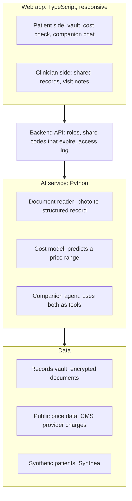

# Health companion app: project brief

CODE/CLASH 2026, Towson University. Saturday, November 14, 2026.
Working title only. App name and companion name are still open.

## 1. What we're building

A website that works on phones and laptops and helps students and young adults handle their own healthcare.

It does three things:

1. Keeps their medical paperwork in one place.
2. Shows what a visit will likely cost before they go.
3. Gives them an AI companion that answers questions using their own records.

### Prompt fit

The official prompt is Break the Barrier: how can technology break down barriers to personal growth, professional opportunity and educational advancement?

Our answer in the organizers' formula:

| Part | Ours |
| --- | --- |
| Community | Students and young adults managing their own healthcare for the first time |
| Issue | Unknown prices and lost paperwork lead to skipped care, missed class and missed work |
| Technology | A patient-owned records vault, a trained cost estimator and an AI companion |
| Solution | Care that stops derailing school and work |

How it hits each pillar:

- **Educational:** fewer missed classes, and immunization or physical forms are ready when a school or clinical placement asks for them.
- **Professional:** fewer missed shifts, and onboarding health paperwork is ready for a new job.
- **Personal:** users learn to read their own records and understand what care costs.

### Track

Community & Social Impact for now. Switch to AI & Data at 4:00 PM if the trained cost model becomes the strongest part of the demo. Every team is also entered for Best Overall.

## 2. Who it's for and the problem

Our users are students and young adults who have just started managing their own healthcare, often without a parent keeping track for them.

- **They skip care over cost.** 36% of adults skipped or postponed care they needed in the past year because of cost. Source: KFF, April 2026.
- **Affordability is falling fastest for our age group.** The share of 18 to 29 year olds who could afford care fell from 46% in 2021 to 32% in 2025. Source: Gallup and West Health survey.
- **They can't see the price first.** A sore throat could mean the campus health center, a retail clinic, urgent care or an ER, and the bills are very different.
- **Their paperwork is scattered.** Visit summaries, lab results and immunization records sit on paper and in separate portals, and schools and employers keep asking for them.

### Persona for the pitch

Maya is a sophomore who works part time. She thinks she has strep, has no idea what a visit costs, and can't find the immunization record her clinical placement form needs. The name is a placeholder.

## 3. The visit loop

The whole product, and the whole demo, is one loop around a clinic visit.

1. **Before the visit.** The user tells the companion what's wrong. It shows a cost range for the options nearby and lists which records to bring.
2. **During the visit.** The user shares the records they choose with the clinician through a code that expires. The clinician sees that packet and can add a visit note.
3. **After the visit.** The user snaps a photo of the paperwork. The app reads it, files it on a timeline and explains it in plain language.

### Demo script

1. Maya asks the companion about strep and gets a cost range.
2. She shares her immunization record with a clinician by code.
3. She uploads the visit summary and asks the companion what it means.

## 4. Scope

Build one path that works end to end before adding anything else.

### Must have by 4:00 PM

- [ ] Responsive web app with a patient role and a clinician role
- [ ] Upload or photograph a document, see it parsed and filed on a timeline
- [ ] Cost estimate: pick a service and get a price range from our trained model
- [ ] Companion chat that can search the user's records and call the cost model
- [ ] Share by code: clinician view of the records the patient chose

### Nice to have

- Clinician adds a visit note that appears on the patient timeline
- Comparison of cheaper options across clinic types
- Plain-language and translated explanations of a document
- Reminders for follow-ups and expiring records

### Cut for today

- Real sign-up with email and passwords. Use two seeded demo accounts.
- Real patient data and real clinic integrations
- Insurance plan math. Show an estimate range and label it clearly.
- Native mobile apps

## 5. Architecture



### Suggested stack

These are suggestions. Swap anything the team knows better.

| Layer | Suggestion | Notes |
| --- | --- | --- |
| Web app | Next.js with TypeScript and Tailwind | One codebase. Design at phone width first, then widen. |
| Backend API | Next.js API routes | Role check, share codes, access log, calls to the AI service |
| Database and files | Supabase, or SQLite plus a local folder | Pick whichever is fastest to set up |
| AI service | Python with FastAPI | Three endpoints: extract, estimate, chat |
| Document reader | An LLM API that accepts images | Returns JSON: document type, date, provider, key fields, short summary |
| Cost model | scikit-learn | See section 6 |
| Companion | LLM with two tools | search_records and estimate_cost |
| Demo data | Synthea | Open-source synthetic patients. No real health information. |

### Repo layout

```
/web        Next.js app: pages, components, API routes
/ai         FastAPI service: extract, estimate, chat
/ai/model   training script, saved model, metrics.json
/data       CMS pull script, synthetic sample records
/docs       this brief, deck, demo script
README.md   overview, setup, disclosures
```

### Data model

| Table | Fields |
| --- | --- |
| users | id, role, name |
| documents | id, patient_id, type, date, provider, summary, fields as JSON, file_url |
| shares | code, patient_id, document_ids, expires_at |
| access_log | id, share_code, viewer_id, document_id, viewed_at |
| notes | id, patient_id, clinician_id, text, created_at |

### AI service endpoints

| Endpoint | Input | Output |
| --- | --- | --- |
| POST /extract | image or PDF | document type, date, provider, key fields, summary |
| POST /estimate | service code, setting, ZIP | low, typical and high price, plus a caveat line |
| POST /chat | message, patient_id | reply, plus which records or estimates it used |

### Companion rules

- It explains documents and costs. It never diagnoses.
- It says which record an answer came from.
- Urgent symptoms get pointed to real care right away.
- The UI carries a "not a doctor" line near the chat.

### Privacy by design

- The demo uses synthetic records only.
- Sharing needs the patient's action, and each share code expires.
- Every clinician view is written to the access log, and the patient can see it.
- Say "designed with HIPAA in mind". Do not say "HIPAA compliant".

## 6. Cost model plan

The goal is a small model we really trained and can explain, with an error number we can show.

1. **Get the data.** CMS publishes "Medicare Physician & Other Practitioners by Provider and Service". Each row is one provider and one service code, with the provider's average submitted charge and Medicare's average allowed amount. It has a free API and can be filtered by state.
   - Dataset page: https://data.cms.gov/provider-summary-by-type-of-service/medicare-physician-other-practitioners/medicare-physician-other-practitioners-by-provider-and-service
   - API endpoint seen in the federal data catalog: https://data.cms.gov/data-api/v1/dataset/92396110-2aed-4d63-a6a2-5d6207d46a29/data
   - Confirm the exact column names against the data dictionary on that page before coding.
2. **Filter.** Maryland providers only. Keep a short list of services students actually use. Suggested codes to check in the data: 99213 and 99203 for office visits, 87880 for a rapid strep test, 87804 for a rapid flu test, 86580 for a TB skin test, 90471 for giving a vaccine, 85025 for a blood count.
3. **Features.** Service code, provider type, office or facility setting, first three digits of ZIP.
4. **Target.** Average submitted charge, on a log scale.
5. **Model.** Gradient boosting in scikit-learn. Train three quantile models for the 10th, 50th and 90th percentile so the app shows a range and not one number.
6. **Evaluate.** Hold out 20% of providers. Report mean absolute error next to a simple baseline, the median price per code. Save both numbers to metrics.json and put them on a slide.
7. **Serve.** Load the saved model in the FastAPI service behind /estimate.

**Limitation to say out loud.** These are charges billed to Medicare. They are not what a student's own insurance pays. The app labels every number as an estimate range. Next step after the hackathon would be hospital price transparency files and clinic self-pay price lists.

## 7. Division of work

Write a name in the Owner column. Everyone should own at least one piece of code they can explain, because judges may open the repo and ask.

| # | Workstream | Owns | Done when | Best fit | Owner |
| --- | --- | --- | --- | --- | --- |
| A | Web app and UI | App shell, responsive layout, patient and clinician screens, upload flow, timeline, chat screen | Demo script runs on a phone and a laptop | Strongest front-end person, with the Designer role | |
| B | Backend and data | Database tables, two seeded demo accounts, share codes with expiry, access log, routes that call the AI service, deployment | A clinician account can open a shared record by code and the view is logged | Builder and Defender roles | |
| C | AI service | Document reader, companion agent with its two tools, companion rules | A photo becomes a filed record, and the companion answers from it | Most experienced with LLM APIs | |
| D | Cost model | CMS data pull, cleaning, training, metrics, the estimate endpoint | /estimate returns a range and metrics.json exists | Analyst role, comfortable with Python | |
| E | Story and submission | Persona, stats, deck, demo video, Devpost page, README disclosures, Q&A prep, testing the demo path | Submitted on Devpost by 5:45 PM | Strategist role | |

### If the team is smaller

- **Four people:** one each on A, B and E. One person takes C and D together.
- **Three people:** one person takes A and B. One takes C and D. One takes E plus design polish, synthetic data and testing.
- **Two people:** one takes B, C and D. One takes A and E. Drop the clinician visit note.

The owner of E should still own one small piece of code, for example the synthetic data script or the cost estimate card.

## 8. Timeline

Event fixed points: lunch at 12:00, team checkpoint at 2:00, Career Center workshop at 3:00, mini challenge at 3:30, pitch workshop at 4:30, code freeze at 6:00.

### By 12:00 PM: foundations

- [ ] Public GitHub repo, everyone can push
- [ ] App shell deployed and opens on a phone
- [ ] CMS data pulled for Maryland
- [ ] Synthetic demo patients generated

### By the 2:00 PM checkpoint: each piece works alone

- [ ] Upload a document and see it parsed
- [ ] Cost model trained, error number written down, /estimate returns a range
- [ ] Two seeded accounts: one patient, one clinician

### By 4:00 PM: the loop works end to end, then feature freeze

- [ ] Companion answers from records and calls the cost model
- [ ] Share by code shows records in the clinician view
- [ ] Full demo script runs twice in a row with no errors

### 4:30 PM: pitch workshop

- [ ] At least one person attends

### 5:00 to 5:40 PM: submission

- [ ] Five-slide deck
- [ ] Demo video recorded. It doubles as the backup if the live demo fails.
- [ ] Devpost filled in: description, problem, how we built it, technologies, teammates, track
- [ ] README lists every library, API, dataset and AI tool used

### 5:45 PM: submit

Do not wait for 6:00. No code changes are allowed after 6:00 PM. Presentations start at 6:15 PM.

## 9. Judging rubric map

50 points total, 10 per category.

| Criterion | What judges ask | What we show |
| --- | --- | --- |
| Prompt Alignment | How well does it address the prompt? | Open with the formula sentence. Name the pillar each feature serves. |
| Technical Execution | How effectively was it built? | A working end-to-end loop, a model we trained with a reported error, two services talking to each other, a layout that works on a phone |
| Innovation | How creative or original is it? | The patient owns the vault across any clinic, paper included. Price before the visit. A companion that acts on records and cost together. |
| User Impact | How meaningful is the value to users? | Maya's story, the two statistics, and the privacy design |
| Polish & Presentation | How well is it demonstrated and explained? | A rehearsed four-minute run, a clean deck, a backup video |

## 10. Rules and submission checklist

From the starter kit and the opening slides.

- [ ] Core project code was written between 10:30 AM and 6:00 PM today
- [ ] Existing libraries, APIs, starter templates and datasets are disclosed
- [ ] AI coding tools are allowed, and every teammate can explain the code in their part, including AI-assisted code
- [ ] Submitted on the CODE/CLASH Devpost by 6:00 PM: https://code-clash.devpost.com/
- [ ] GitHub repo is public and opens for judges
- [ ] One prize track selected
- [ ] Demo video attached. Recommended, not required.
- [ ] Pitch slide deck ready
- [ ] At least one teammate present for the in-person demo. Everyone is better.

Presentation format: 4 minutes to present and demo live, then 2 minutes of judge questions. Be ready to open the repo and explain key code.

## 11. Pitch outline

| Time | What happens |
| --- | --- |
| 0:00 to 0:30 | Maya's story, one statistic, the formula sentence |
| 0:30 to 2:30 | Live demo of the visit loop |
| 2:30 to 3:15 | How it works: the architecture, the model we trained and its error, what we built today |
| 3:15 to 3:45 | Impact, privacy design, what comes next |
| 3:45 to 4:00 | Buffer |

### Questions to prepare for

- **How is this different from MyChart?** A portal belongs to one health system. Ours belongs to the patient, works across clinics and paper, and shows a price before the visit.
- **Where did the training data come from?** A public CMS dataset of Medicare provider charges. State the limitation from section 6.
- **How accurate is the model?** Give the error number and the baseline from metrics.json.
- **What did AI write and what did you build?** Name the tools used, then each person explains their own part.
- **What if the estimate is wrong?** It is always shown as a range with an estimate label. It is never a quote.
- **How do you handle real patient data?** The demo uses synthetic records. The design has consent, expiring share codes, an access log and encrypted storage. Real use would need full HIPAA compliance work first.
- **Is the companion giving medical advice?** No. It explains documents and costs, and it points urgent symptoms to real care.

## 12. Open decisions

- [ ] App name and companion name. If the companion is called Doc, keep the "not a doctor" line next to it.
- [ ] Owner for each workstream
- [ ] Final track choice at 4:00 PM
- [ ] Which LLM API to use for the document reader and companion

## 13. Sources

- KFF, Americans' Challenges with Health Care Costs, updated April 30, 2026: https://www.kff.org/health-costs/report/americans-challenges-with-health-care-costs/
- Straight Arrow News on the Gallup and West Health affordability survey: https://san.com/cc/in-a-5-year-low-most-americans-say-they-can-no-longer-afford-healthcare/
- CMS dataset, Medicare Physician & Other Practitioners by Provider and Service: https://data.cms.gov/provider-summary-by-type-of-service/medicare-physician-other-practitioners/medicare-physician-other-practitioners-by-provider-and-service
- Synthea synthetic patient generator: https://github.com/synthetichealth/synthea
- CODE/CLASH Devpost: https://code-clash.devpost.com/
- CODE/CLASH site and schedule: https://codeclashtu.com/
- CODE/CLASH 2026 starter kit PDF and opening ceremony slides from the organizers
